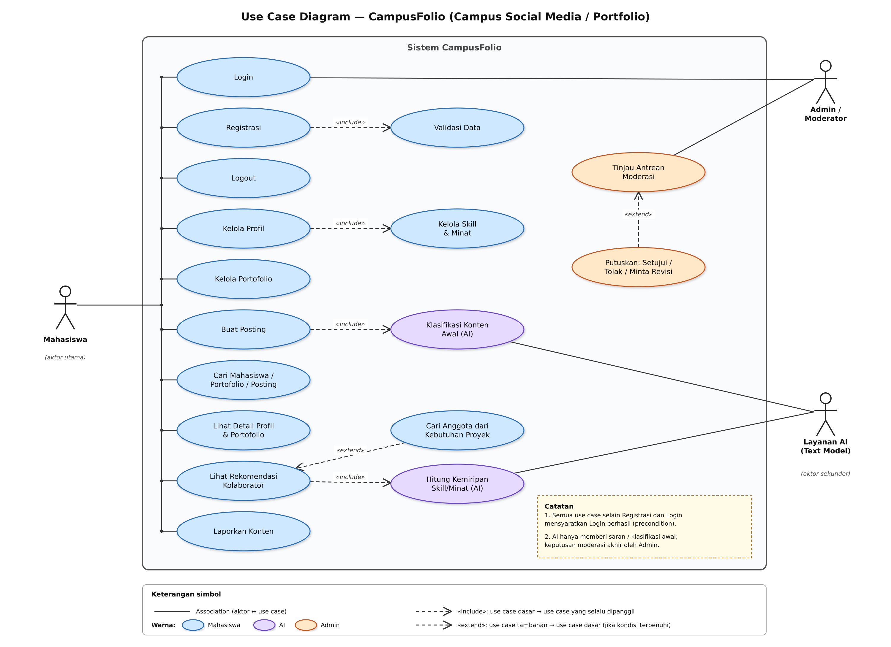
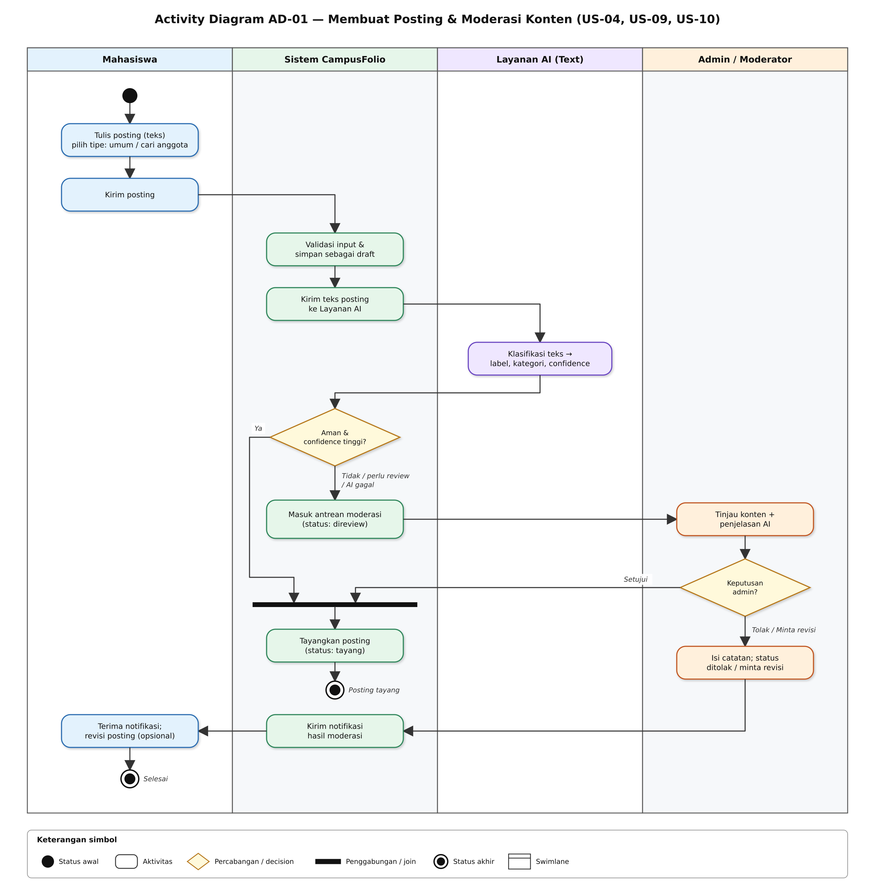
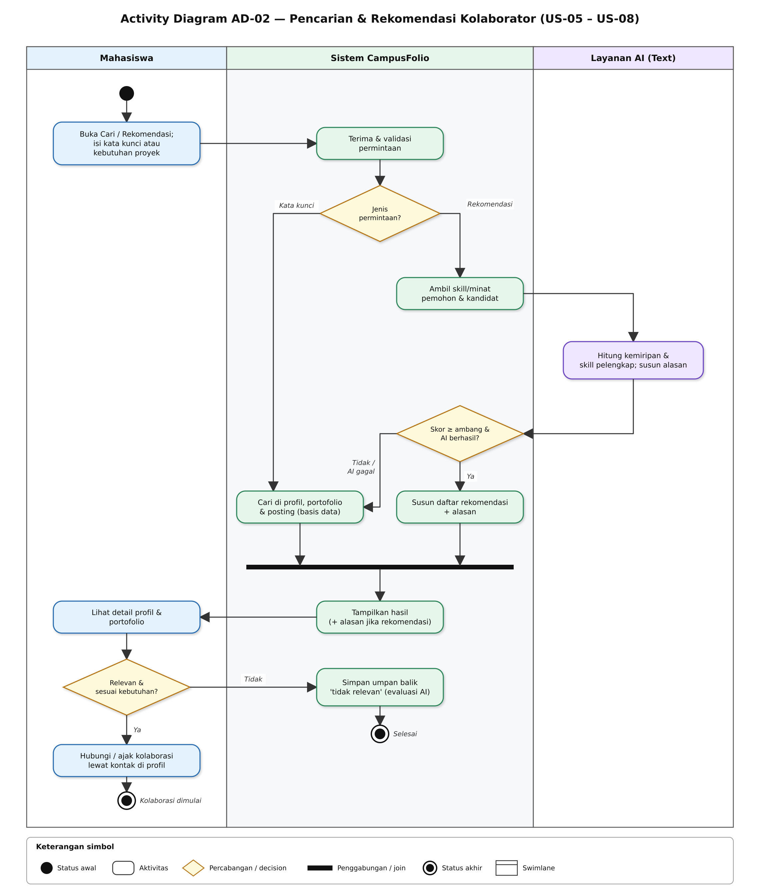
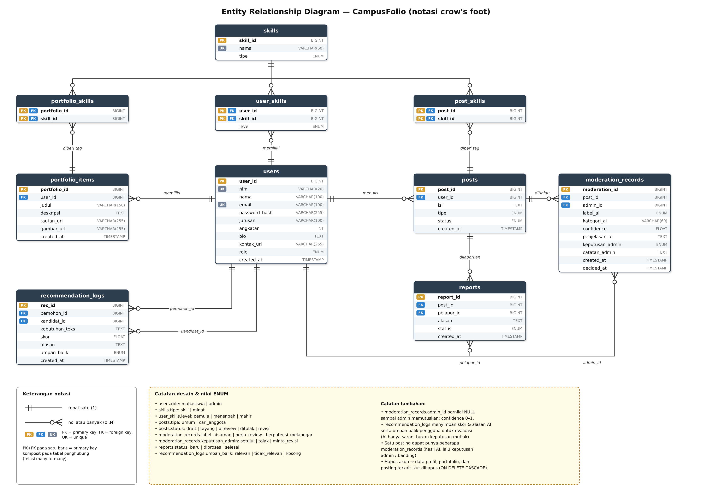

# Desain Sistem — CampusFolio (Campus Social Media/Portfolio, Team 3)

Status: **Draft v0.1** · 17 Oktober 2026 · Turunan dari `04-prd.md` dan `05-initial-backlog.md`

Dokumen ini berisi tiga diagram perancangan sistem (use case, activity, ERD) beserta penjelasan, matriks keterlacakan ke user story, dan keputusan yang masih perlu disepakati tim. Notasi mengikuti materi kelas *Perancangan Sistem*.

## 1. Ringkasan

| Diagram | Menjawab pertanyaan | File gambar | Sumber yang bisa diedit |
|---|---|---|---|
| Use Case Diagram | Siapa memakai sistem dan fitur apa yang tersedia? | `diagrams/use-case.svg` / `.png` | dibuat langsung sebagai SVG |
| Activity Diagram AD-01 | Bagaimana posting dibuat, diklasifikasi AI, dan dimoderasi? | `diagrams/activity-posting-moderasi.svg` / `.png` | `diagrams/mermaid/activity-posting-moderasi.mmd` |
| Activity Diagram AD-02 | Bagaimana pencarian dan rekomendasi kolaborator berjalan? | `diagrams/activity-pencarian-rekomendasi.svg` / `.png` | `diagrams/mermaid/activity-pencarian-rekomendasi.mmd` |
| ERD | Data apa yang disimpan dan bagaimana relasinya? | `diagrams/erd.svg` / `.png` | `diagrams/mermaid/erd.mmd`, `schema.sql` |

File `.svg` adalah versi utama (tajam di layar mana pun). File `.mmd` adalah sumber Mermaid yang lebih mudah diedit tim; tata letaknya dibuat otomatis sehingga tidak persis sama dengan gambar SVG. Agar tampil di GitHub, tempel isinya ke blok kode berlabel `mermaid`.

---

## 2. Use Case Diagram



### 2.1 Aktor

| Aktor | Jenis | Peran |
|---|---|---|
| Mahasiswa | Utama | Mengelola profil dan portofolio, membuat posting, mencari dan menerima rekomendasi kolaborator, melaporkan konten |
| Admin / Moderator | Utama | Meninjau antrean moderasi dan memutuskan hasil akhir (human review) |
| Layanan AI (Text) | Sekunder (sistem lain) | Menghitung kemiripan skill/minat dan memberi klasifikasi awal konten; tidak berinteraksi langsung dengan pengguna |

### 2.2 Daftar use case

| Kode | Use case | Aktor | Relasi | User story |
|---|---|---|---|---|
| UC-01 | Registrasi | Mahasiswa | include UC-02 | belum ada (lihat bagian 7, keputusan 3) |
| UC-02 | Validasi Data | — | di-include UC-01 | — |
| UC-03 | Login | Mahasiswa, Admin | — | US-01 |
| UC-04 | Logout | Mahasiswa | — | US-12 |
| UC-05 | Kelola Profil | Mahasiswa | include UC-06 | US-02 |
| UC-06 | Kelola Skill & Minat | — | di-include UC-05 | US-02 |
| UC-07 | Kelola Portofolio | Mahasiswa | — | US-03 |
| UC-08 | Buat Posting | Mahasiswa | include UC-09 | US-04 |
| UC-09 | Klasifikasi Konten Awal (AI) | Layanan AI | di-include UC-08 | US-09 |
| UC-10 | Cari Mahasiswa / Portofolio / Posting | Mahasiswa | — | US-05 |
| UC-11 | Lihat Detail Profil & Portofolio | Mahasiswa | — | US-06 |
| UC-12 | Lihat Rekomendasi Kolaborator | Mahasiswa | include UC-13 | US-07 |
| UC-13 | Hitung Kemiripan Skill/Minat (AI) | Layanan AI | di-include UC-12 | US-07 |
| UC-14 | Cari Anggota dari Kebutuhan Proyek | Mahasiswa | extend UC-12 | US-08 |
| UC-15 | Laporkan Konten | Mahasiswa | — | US-11 |
| UC-16 | Tinjau Antrean Moderasi | Admin | — | US-10 |
| UC-17 | Putuskan: Setujui / Tolak / Minta Revisi | Admin | extend UC-16 | US-10 |

### 2.3 Cara membaca relasi

- **Association** (garis polos): aktor memakai use case. Pada gambar, garis Mahasiswa digabung dalam satu garis penghubung vertikal agar tidak melintasi use case lain.
- **«include»**: use case dasar *selalu* memanggil use case yang di-include. Contoh: Buat Posting selalu menjalankan Klasifikasi Konten Awal.
- **«extend»**: use case tambahan hanya berjalan jika kondisi terpenuhi. Contoh: Cari Anggota dari Kebutuhan Proyek hanya terjadi bila mahasiswa menulis kebutuhan proyek; Putuskan Moderasi hanya terjadi setelah admin membuka satu item antrean.
- **Precondition umum:** semua use case selain Registrasi dan Login mensyaratkan Login berhasil. Ini ditulis sebagai catatan pada diagram, bukan garis *include*, supaya diagram tidak penuh garis.

### 2.4 Spesifikasi use case kunci

**UC-08 Buat Posting**

| Item | Isi |
|---|---|
| Aktor | Mahasiswa (utama), Layanan AI (sekunder) |
| Precondition | Mahasiswa sudah login |
| Alur utama | 1) Mahasiswa menulis isi dan memilih tipe (umum / cari anggota). 2) Sistem memvalidasi input dan menyimpan sebagai `draft`. 3) Sistem mengirim teks ke Layanan AI. 4) AI mengembalikan label, kategori, dan confidence. 5) Jika aman dan confidence tinggi, status menjadi `tayang`. |
| Alur alternatif | A1) Label `perlu_review` / `berpotensi_melanggar`, confidence rendah, atau AI gagal: status `direview` dan masuk antrean moderasi (lanjut UC-16). A2) Input tidak valid: sistem menampilkan pesan kesalahan, posting tidak disimpan. |
| Postcondition | Posting tersimpan dengan status `tayang` atau `direview`; hasil klasifikasi tercatat di `moderation_records` |

**UC-12 Lihat Rekomendasi Kolaborator**

| Item | Isi |
|---|---|
| Aktor | Mahasiswa (utama), Layanan AI (sekunder) |
| Precondition | Login; profil memiliki minimal satu skill atau minat |
| Alur utama | 1) Sistem mengambil skill/minat pemohon dan kandidat. 2) AI menghitung kemiripan dan skill pelengkap beserta alasan. 3) Jika skor di atas ambang, sistem menampilkan daftar rekomendasi dengan alasan. 4) Hasil dicatat di `recommendation_logs`. |
| Alur alternatif | A1) Skor di bawah ambang atau AI gagal: sistem beralih ke pencarian kata kunci/tag (fallback). A2) Mahasiswa menandai hasil "tidak relevan": umpan balik disimpan untuk evaluasi. |
| Postcondition | Mahasiswa melihat daftar kandidat; rekomendasi diperlakukan sebagai saran, bukan keputusan |

**UC-16 / UC-17 Tinjau dan Putuskan Moderasi**

| Item | Isi |
|---|---|
| Aktor | Admin / Moderator |
| Precondition | Login sebagai admin; ada item berstatus `direview` |
| Alur utama | 1) Admin membuka antrean dan memilih item. 2) Sistem menampilkan isi posting beserta label, kategori, confidence, dan penjelasan AI. 3) Admin memutuskan: setujui (status `tayang`), tolak (`ditolak`), atau minta revisi (`revisi`). 4) Sistem menyimpan keputusan, catatan, dan waktu, lalu mengirim notifikasi ke mahasiswa. |
| Postcondition | Keputusan akhir ada di tangan admin; AI tidak pernah menghapus konten sensitif otomatis |

---

## 3. Activity Diagram

Simbol sesuai materi kelas: status awal (lingkaran hitam), aktivitas (persegi bulat, diawali kata kerja), percabangan (belah ketupat), penggabungan/join (garis tebal), status akhir (lingkaran ganda), dan swimlane (satu jalur per pelaku).

### 3.1 AD-01 — Membuat Posting dan Moderasi Konten



Ringkasan alur: mahasiswa mengirim posting, sistem memvalidasi lalu meminta klasifikasi AI. Hasil **aman dengan confidence tinggi** langsung tayang. Hasil lain (perlu review, berpotensi melanggar, confidence rendah, atau AI gagal) masuk antrean, ditinjau admin. Keputusan **setujui** menggabungkan alur ke penayangan; **tolak / minta revisi** menghasilkan catatan dan notifikasi kepada mahasiswa. Garis tebal adalah *join*: dua jalur berbeda bertemu pada langkah "Tayangkan posting".

### 3.2 AD-02 — Pencarian dan Rekomendasi Kolaborator



Ringkasan alur: sistem menentukan jenis permintaan. **Kata kunci** langsung ke pencarian basis data. **Rekomendasi** melewati Layanan AI; bila skor di bawah ambang atau AI gagal, sistem memakai pencarian yang sama sebagai fallback sehingga fitur inti tidak berhenti. Kedua jalur bergabung di "Tampilkan hasil". Mahasiswa lalu melihat detail; hasil yang tidak relevan disimpan sebagai umpan balik untuk mengevaluasi AI.

### 3.3 Aturan bisnis yang tercermin

| Kode | Aturan | Sumber |
|---|---|---|
| BR-01 | AI hanya memberi klasifikasi/rekomendasi awal; keputusan moderasi sensitif selalu oleh manusia | Batasan Kasus 3 |
| BR-02 | Kegagalan AI tidak boleh menghentikan fitur inti (posting dan pencarian tetap jalan lewat fallback) | AI hypothesis, bagian "jika AI salah" |
| BR-03 | Setiap rekomendasi disertai alasan singkat | NFR keterjelasan di PRD |
| BR-04 | Semua keputusan moderasi tercatat (siapa, kapan, catatan) | Audit dan evaluasi |

---

## 4. Entity Relationship Diagram



Skema SQL siap pakai ada di `schema.sql` (sintaks PostgreSQL; sudah lolos pemeriksaan sintaks, belum dijalankan terhadap server basis data).

### 4.1 Tabel dan tujuannya

| Tabel | Tujuan | Data awal dari kelas |
|---|---|---|
| `users` | Akun mahasiswa dan admin, plus profil (jurusan, angkatan, bio, kontak) | profil |
| `skills` | Daftar skill dan minat yang dinormalisasi (satu nama, satu baris) | skill, minat |
| `user_skills` | Skill/minat milik tiap pengguna, dengan level | skill, minat |
| `portfolio_items` | Karya pengguna (judul, deskripsi, tautan, gambar) | portofolio |
| `portfolio_skills` | Tag skill pada tiap karya | portofolio |
| `posts` | Posting beserta tipe dan status moderasinya | posting |
| `post_skills` | Skill yang dicari pada posting "cari anggota" | posting |
| `moderation_records` | Hasil klasifikasi AI dan keputusan admin per posting | AI hypothesis, batasan |
| `reports` | Laporan konten dari mahasiswa | fitur moderasi |
| `recommendation_logs` | Riwayat rekomendasi: skor, alasan, dan umpan balik | AI hypothesis |

### 4.2 Relasi

| Relasi | Kardinalitas | Keterangan |
|---|---|---|
| `users` — `portfolio_items` | 1 : 0..N | satu pengguna punya banyak karya |
| `users` — `posts` | 1 : 0..N | satu pengguna menulis banyak posting |
| `users` — `user_skills` — `skills` | N : M | lewat tabel penghubung, PK komposit |
| `portfolio_items` — `portfolio_skills` — `skills` | N : M | tag skill pada karya |
| `posts` — `post_skills` — `skills` | N : M | skill yang dicari |
| `posts` — `moderation_records` | 1 : 0..N | satu posting bisa punya beberapa catatan (hasil AI, keputusan, banding) |
| `users` — `moderation_records` | 1 : 0..N | lewat `admin_id`, kosong sampai admin memutuskan |
| `posts` — `reports` dan `users` — `reports` | 1 : 0..N | lewat `post_id` dan `pelapor_id` |
| `users` — `recommendation_logs` | 1 : 0..N (dua kali) | lewat `pemohon_id` dan `kandidat_id` |

### 4.3 Catatan desain

- `skills` dibuat tabel tersendiri agar "React", "reactjs", dan "React.js" dapat disatukan; teks bebas di bio tetap dipakai AI untuk kemiripan semantik.
- Kata sandi disimpan hanya sebagai `password_hash`, tidak pernah teks asli.
- Hapus akun memakai `ON DELETE CASCADE` untuk data milik pengguna; `admin_id` memakai `SET NULL` agar riwayat moderasi tetap ada.
- Nilai ENUM ditulis sebagai `VARCHAR` + `CHECK` supaya portabel antar basis data. Daftar nilainya ada pada kotak catatan di ERD.

---

## 5. Matriks Keterlacakan

| User story | Use case | Activity | Tabel utama |
|---|---|---|---|
| US-01 Login | UC-03 | — | `users` |
| US-02 Kelola profil | UC-05, UC-06 | — | `users`, `user_skills`, `skills` |
| US-03 Portofolio | UC-07 | — | `portfolio_items`, `portfolio_skills` |
| US-04 Buat posting | UC-08 | AD-01 | `posts`, `post_skills` |
| US-05 Cari | UC-10 | AD-02 | `users`, `portfolio_items`, `posts`, `skills` |
| US-06 Lihat detail | UC-11 | AD-02 | `users`, `portfolio_items` |
| US-07 Rekomendasi | UC-12, UC-13 | AD-02 | `user_skills`, `recommendation_logs` |
| US-08 Kebutuhan proyek | UC-14 | AD-02 | `post_skills`, `recommendation_logs` |
| US-09 Klasifikasi AI | UC-09 | AD-01 | `moderation_records` |
| US-10 Antrean moderasi | UC-16, UC-17 | AD-01 | `moderation_records`, `posts` |
| US-11 Laporkan konten | UC-15 | — | `reports` |
| US-12 Logout | UC-04 | — | `users` |

Catatan: Laporkan Konten (UC-15) belum punya activity diagram sendiri; alurnya sederhana dan dapat ditambahkan pada sprint berikutnya.

---

## 6. Cara Memakai di Repository

Susunan file yang dianjurkan (sesuai struktur `docs/` pada PRD):

```text
docs/
├── 08-system-design.md          # dokumen ini
├── schema.sql
└── diagrams/
    ├── use-case.svg  / .png
    ├── activity-posting-moderasi.svg  / .png
    ├── activity-pencarian-rekomendasi.svg  / .png
    ├── erd.svg  / .png
    └── mermaid/
        ├── erd.mmd
        ├── activity-posting-moderasi.mmd
        └── activity-pencarian-rekomendasi.mmd
```

Saran alur kerja tim: buat branch `docs/system-design`, commit file-file di atas, lalu buka pull request kecil untuk direview anggota lain. Issue yang bisa dibuat: `design: review use case diagram`, `design: finalisasi skema basis data`, `docs: tambah user story registrasi (US-13)`.

---

## 7. Keputusan dan Pertanyaan Terbuka

1. **Moderasi sebelum atau sesudah tayang?** Diagram saat ini memakai *sebelum tayang*: posting berstatus `draft` sampai AI menyatakan aman. Jika tim ingin langsung tayang lalu ditinjau belakangan, AD-01 perlu diubah.
2. **Ambang confidence AI.** Belum ditetapkan. Usulan awal 0,80 dan perlu diuji pada data contoh.
3. **Registrasi belum punya user story.** UC-01 muncul di diagram tetapi backlog (US-01 s.d. US-12) tidak memuatnya. Usulan: tambahkan US-13 "Sebagai mahasiswa, saya ingin mendaftar agar dapat memiliki akun". Pertimbangkan juga pembatasan email kampus.
4. **Laporan pengguna masuk antrean?** Usulan: laporan mengubah status posting menjadi `direview` dan membuat baris di `moderation_records` dengan `label_ai` kosong. Perlu disepakati, termasuk apakah posting disembunyikan selama ditinjau.
5. **Cara mahasiswa dihubungi.** Chat tidak termasuk MVP, sehingga kontak lewat kolom `kontak_url` di profil (WhatsApp, LinkedIn, atau lainnya). Perlu diputuskan apakah kontak boleh disembunyikan.
6. **Pembuatan akun admin.** Usulan: diisi manual lewat data awal (seed), tanpa antarmuka khusus pada MVP.
7. **Basis data final.** `schema.sql` memakai sintaks PostgreSQL; sesuaikan bila tim memilih MySQL atau SQLite.
8. **Nilai ENUM dan batas panjang kolom** adalah usulan awal dan dapat direvisi bersama.
