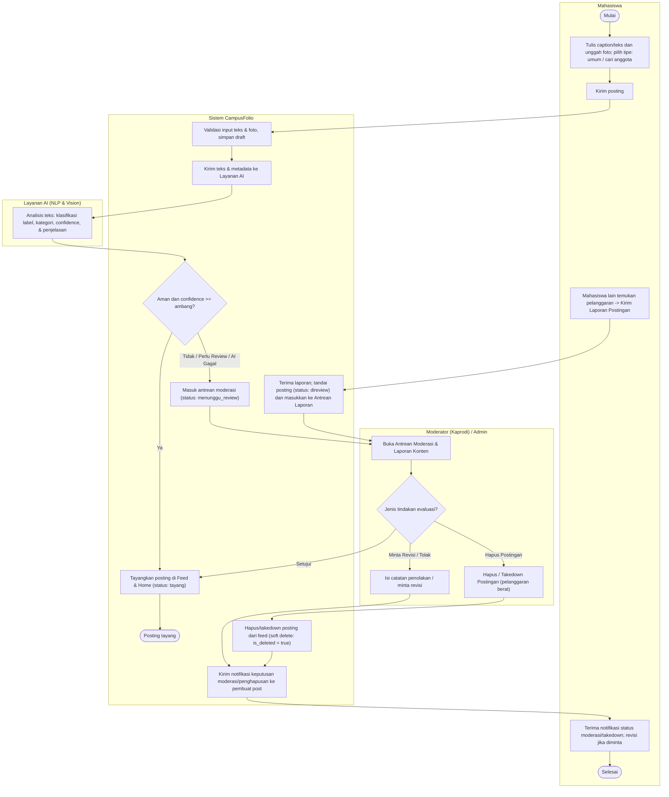
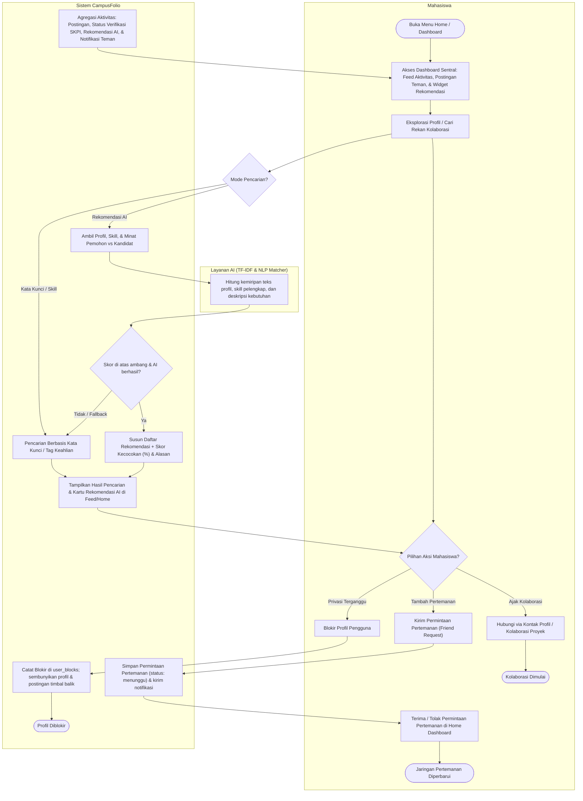
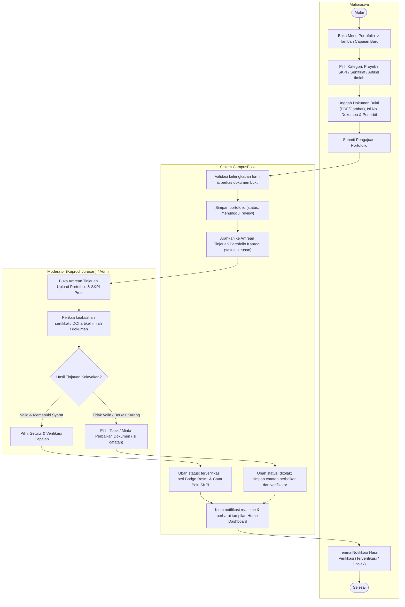

# Desain Sistem — CampusFolio (Campus Social Media/Portfolio, Team 3)

Status: **Revisi v1.1** · 27 Oktober 2026 · Turunan dari `04-prd.md` dan `05-initial-backlog.md`  
Perubahan Klien: Penambahan role Moderator (Kaprodi), Pertemanan, Blokir Profil, SKPI/Sertifikat/Artikel Ilmiah, Tinjauan Konten & Portofolio, Pelaporan & Penghapusan Postingan, serta Integrasi Seluruh Aktivitas ke Dashboard Home.

---

## 1. Ringkasan Diagram

| Diagram | Menjawab Pertanyaan | File Gambar / Vektor | Sumber Mermaid |
| :--- | :--- | :--- | :--- |
| **Use Case Diagram** | Siapa yang memakai sistem dan fitur apa yang tersedia untuk masing-masing role? | `diagrams/use-case.svg` / `.png` | Skenario Use Case v1.1 |
| **Activity Diagram AD-01** | Bagaimana alur posting foto+teks, inspeksi AI, laporan pelanggaran, serta tinjauan dan takedown postingan oleh Kaprodi/Admin? | `diagrams/activity-posting-moderasi.svg` / `.png` | `diagrams/mermaid/activity-posting-moderasi.mmd` |
| **Activity Diagram AD-02** | Bagaimana alur navigasi Dashboard Home terpadu, pengelolaan pertemanan mahasiswa, blokir profil, dan rekomendasi kolaborator AI? | `diagrams/activity-pencarian-rekomendasi.svg` / `.png` | `diagrams/mermaid/activity-pencarian-rekomendasi.mmd` |
| **Activity Diagram AD-03** | Bagaimana alur unggah dokumen portofolio (SKPI, Sertifikat, Artikel Ilmiah) dan proses verifikasi oleh Kaprodi? | `diagrams/activity-portofolio-skpi.svg` / `.png` | `diagrams/mermaid/activity-portofolio-skpi.mmd` |
| **Entity Relationship Diagram (ERD)** | Data apa saja yang disimpan dan bagaimana relasi antar entitas (termasuk pertemanan, blokir, takedown, dan verifikasi SKPI)? | `diagrams/erd.svg` / `.png` | `diagrams/mermaid/erd.mmd`, `schema.sql` |

---

## 2. Use Case Diagram

### 2.1 Aktor
1. **Mahasiswa (Aktor Utama):** Pengguna inti platform yang mengelola profil, mengunggah portofolio (karya, sertifikat, SKPI, artikel ilmiah), membuat postingan foto & teks, menjalin pertemanan, memblokir pengguna jika diperlukan, serta melaporkan konten melanggar.
2. **Moderator / Kaprodi (Aktor Utama):** Kepala Program Studi yang memiliki wewenang khusus untuk memoderasi postingan mahasiswa prodinya, meninjau dan memvalidasi pengajuan SKPI dan artikel ilmiah, memproses laporan pelanggaran, serta melakukan takedown (hapus postingan).
3. **Admin Kemahasiswaan (Aktor Utama):** Administrator tingkat universitas yang memiliki kontrol moderasi global lintas program studi, pengelolaan akun, dan eskalasi laporan.
4. **Layanan AI (Aktor Sekunder / Sistem Eksternal):** Model Text NLP (TF-IDF Matcher & Content Moderator) yang bertugas menghitung kecocokan rekomendasi dan memindai teks postingan secara otomatis.

### 2.2 Daftar Use Case

| Kode | Use Case | Aktor | Relasi | User Story |
| :--- | :--- | :--- | :--- | :--- |
| **UC-01** | Registrasi & Login | Mahasiswa, Moderator, Admin | — | US-01 |
| **UC-02** | Logout | Semua Aktor | — | US-12 |
| **UC-03** | Kelola Profil & Skill/Minat | Mahasiswa | — | US-02 |
| **UC-04** | Akses Home Dashboard Terpadu | Mahasiswa, Moderator, Admin | — | US-18 |
| **UC-05** | Kelola Pertemanan (Kirim/Terima/Tolak) | Mahasiswa | — | US-13 |
| **UC-06** | Blokir Profil Pengguna | Mahasiswa | — | US-14 |
| **UC-07** | Upload Portofolio (Karya, SKPI, Sertifikat, Artikel Ilmiah) | Mahasiswa | — | US-03, US-15 |
| **UC-08** | Buat Postingan (Fokus Foto + Teks) | Mahasiswa | `«include»` UC-09 | US-04 |
| **UC-09** | Klasifikasi Awal Konten Teks (AI) | Layanan AI | di-include UC-08 | US-09 |
| **UC-10** | Cari Mahasiswa / Portofolio / Postingan | Mahasiswa | — | US-05 |
| **UC-11** | Lihat Detail Profil & Portofolio Mahasiswa | Mahasiswa | — | US-06 |
| **UC-12** | Lihat Rekomendasi Kolaborator AI | Mahasiswa | `«include»` UC-13 | US-07 |
| **UC-13** | Hitung Kemiripan TF-IDF & Cosine Similarity | Layanan AI | di-include UC-12 | US-07, US-08 |
| **UC-14** | Laporkan Postingan Melanggar | Mahasiswa | — | US-11 |
| **UC-15** | Tinjau Antrean Postingan & Laporan Konten | Moderator (Kaprodi), Admin | — | US-10 |
| **UC-16** | Tinjau & Validasi Upload Portofolio / SKPI | Moderator (Kaprodi), Admin | — | US-16 |
| **UC-17** | Hapus / Takedown Postingan Pelanggar | Moderator (Kaprodi), Admin | `«extend»` UC-15 | US-17 |

---

## 3. Activity Diagram

### 3.1 AD-01 — Pembuatan Postingan (Foto + Teks), Pelaporan, & Tinjauan/Hapus Postingan
Diagram ini memodelkan siklus hidup postingan feed dan penegakan moderasi:
1. **Pembuatan Postingan:** Mahasiswa menulis teks deskripsi/caption dan mengunggah foto kegiatan.
2. **AI Screening:** Layanan AI memeriksa teks. Konten aman langsung ditayangkan di Home Dashboard. Konten berisiko masuk status `menunggu_review`.
3. **Pelaporan oleh Mahasiswa:** Setiap mahasiswa dapat melaporkan postingan yang melanggar norma (spam, ujaran kebencian, plagiarisme). Postingan masuk antrean prioritas.
4. **Tinjauan oleh Kaprodi / Admin:** Moderator (Kaprodi sesuai prodi) atau Admin memeriksa postingan dan laporan.
5. **Keputusan Moderasi:** Moderator dapat menyetujui, meminta revisi, atau langsung **menghapus postingan (takedown)** dengan mencatat alasan penghapusan ke audit trail (`deleted_by`, `alasan_hapus`).

---

### 3.2 AD-02 — Home Dashboard Terpadu, Pertemanan, Blokir Profil, & Rekomendasi AI
Diagram ini memodelkan interaksi sentral di halaman Dashboard Home:
1. **Dashboard Sentral:** Mengagregasi postingan linimasa terbaru (dari teman & kampus), daftar rekomendasi kolaborator AI, dan notifikasi pertemanan.
2. **Sistem Pertemanan:** Mahasiswa dapat mengirim *Friend Request* dan menerima/menolak di widget Dashboard.
3. **Fitur Blokir Profil:** Jika ada pengguna yang mengganggu atau privasi terancam, mahasiswa dapat memblokir profil tersebut. Profil dan konten pengguna yang diblokir otomatis disembunyikan secara timbal balik.
4. **Pencarian & Rekomendasi Kolaborator:** Rekomendasi cerdas AI berbasis TF-IDF memadukan skill yang dibutuhkan dengan kandidat rekan tim yang relevan.

---

### 3.3 AD-03 — Unggah dan Tinjauan Portofolio (SKPI, Sertifikat, & Artikel Ilmiah)
Diagram ini memodelkan proses pengajuan dan validasi portofolio formal:
1. **Pengajuan oleh Mahasiswa:** Mahasiswa memilih kategori (Proyek, SKPI, Sertifikat Kompetensi, atau Artikel Ilmiah), melampirkan berkas bukti (PDF/dokumen), nomor sertifikat/DOI, dan nama penerbit/jurnal.
2. **Antrean Validasi Kaprodi:** Pengajuan masuk ke antrean verifikasi Moderator (Kaprodi) sesuai program studi mahasiswa.
3. **Persetujuan & Catatan:** Kaprodi memverifikasi keabsahan dokumen. Jika valid, status menjadi `terverifikasi` dan diberi badge resmi validasi kampus. Jika tidak lengkap, status `ditolak` dengan catatan perbaikan.

---

## 4. Entity Relationship Diagram (ERD)

Skema basis data diperbarui untuk mengakomodasi seluruh kebutuhan baru:

```mermaid
erDiagram
    users ||--o{ portfolio_items : memiliki
    users ||--o{ posts : menulis
    users ||--o{ user_skills : memiliki
    users ||--o{ moderation_records : "admin_id / moderator_id"
    users ||--o{ reports : "pelapor_id"
    users ||--o{ reports : "ditinjau_oleh"
    users ||--o{ recommendation_logs : "pemohon_id"
    users ||--o{ recommendation_logs : "kandidat_id"
    users ||--o{ friendships : "requester_id"
    users ||--o{ friendships : "addressee_id"
    users ||--o{ user_blocks : "blocker_id"
    users ||--o{ user_blocks : "blocked_id"
    skills ||--o{ user_skills : ""
    skills ||--o{ portfolio_skills : ""
    skills ||--o{ post_skills : ""
    portfolio_items ||--o{ portfolio_skills : "diberi tag"
    posts ||--o{ post_skills : "diberi tag"
    posts ||--o{ moderation_records : ditinjau
    posts ||--o{ reports : dilaporkan

    users {
        bigint user_id PK
        varchar(20) nim UK
        varchar(100) nama
        varchar(100) email UK
        varchar(255) password_hash
        varchar(100) jurusan
        int angkatan
        text bio
        varchar(255) kontak_url
        enum role "mahasiswa, moderator, admin"
        timestamp created_at
    }
    skills {
        bigint skill_id PK
        varchar(60) nama UK
        enum tipe "skill, minat"
    }
    user_skills {
        bigint user_id PK, FK
        bigint skill_id PK, FK
        enum level "pemula, menengah, mahir"
    }
    friendships {
        bigint friendship_id PK
        bigint requester_id FK
        bigint addressee_id FK
        enum status "menunggu, diterima, ditolak"
        timestamp created_at
        timestamp updated_at
    }
    user_blocks {
        bigint block_id PK
        bigint blocker_id FK
        bigint blocked_id FK
        text alasan
        timestamp created_at
    }
    portfolio_items {
        bigint portfolio_id PK
        bigint user_id FK
        varchar(150) judul
        text deskripsi
        varchar(255) tautan_url
        varchar(255) gambar_url
        enum kategori "proyek, skpi, sertifikat, artikel_ilmiah"
        varchar(100) nomor_dokumen
        varchar(150) penerbit
        date tanggal_terbit
        varchar(255) file_url
        enum status_verifikasi "draft, menunggu_review, terverifikasi, ditolak"
        bigint diverifikasi_oleh FK
        text catatan_verifikasi
        timestamp verified_at
        timestamp created_at
    }
    portfolio_skills {
        bigint portfolio_id PK, FK
        bigint skill_id PK, FK
    }
    posts {
        bigint post_id PK
        bigint user_id FK
        text isi
        varchar(255) gambar_url "fokus foto + teks"
        enum tipe "umum, cari_anggota"
        enum status "draft, tayang, menunggu_review, direview, ditolak, revisi, dihapus"
        boolean is_deleted
        timestamp deleted_at
        bigint deleted_by FK
        text alasan_hapus
        timestamp created_at
    }
    post_skills {
        bigint post_id PK, FK
        bigint skill_id PK, FK
    }
    moderation_records {
        bigint moderation_id PK
        bigint post_id FK
        bigint admin_id FK
        bigint moderator_id FK "Kaprodi"
        enum label_ai "aman, perlu_review, berpotensi_melanggar"
        varchar(60) kategori_ai
        float confidence
        text penjelasan_ai
        enum keputusan_admin "setujui, tolak, minta_revisi, hapus_konten"
        enum keputusan_moderator "setujui, tolak, minta_revisi, hapus_konten"
        text catatan_admin
        timestamp created_at
        timestamp decided_at
    }
    reports {
        bigint report_id PK
        bigint post_id FK
        bigint pelapor_id FK
        text alasan
        enum kategori_laporan "spam, konten_tidak_pantas, ujaran_kebencian, dll"
        enum status "baru, diproses, selesai, diabaikan"
        bigint ditinjau_oleh FK "moderator / admin"
        varchar(50) tindakan_diambil "postingan_dihapus, peringatan, dll"
        text catatan_tinjauan
        timestamp created_at
        timestamp resolved_at
    }
    recommendation_logs {
        bigint rec_id PK
        bigint pemohon_id FK
        bigint kandidat_id FK
        text kebutuhan_teks
        float skor
        text alasan
        enum umpan_balik "relevan, tidak_relevan"
        timestamp created_at
    }
```

---

## 5. Matriks Keterlacakan (Traceability Matrix)

| User Story | Use Case | Activity Diagram | Tabel Basis Data Terkait |
| :--- | :--- | :--- | :--- |
| **US-01** Login & Sesi | UC-01 | — | `users` |
| **US-02** Kelola Profil & Skill | UC-03 | — | `users`, `user_skills`, `skills` |
| **US-03** Tambah Portofolio Karya | UC-07 | AD-03 | `portfolio_items`, `portfolio_skills` |
| **US-04** Posting Foto + Teks | UC-08 | AD-01 | `posts`, `post_skills` |
| **US-05** Pencarian Mahasiswa & Skill | UC-10 | AD-02 | `users`, `portfolio_items`, `posts`, `skills` |
| **US-06** Lihat Detail Profil Rekan | UC-11 | AD-02 | `users`, `portfolio_items`, `user_skills` |
| **US-07** Rekomendasi Kolaborator AI | UC-12, UC-13 | AD-02 | `user_skills`, `recommendation_logs` |
| **US-08** Rekomendasi Kebutuhan Proyek | UC-13 | AD-02 | `post_skills`, `recommendation_logs` |
| **US-09** Klasifikasi Konten Awal (AI) | UC-09 | AD-01 | `moderation_records` |
| **US-10** Tinjauan Konten & Laporan | UC-15 | AD-01 | `moderation_records`, `reports`, `posts` |
| **US-11** Laporkan Konten Melanggar | UC-14 | AD-01 | `reports` |
| **US-12** Logout Akun | UC-02 | — | `users` |
| **US-13** Tambah Pertemanan Mahasiswa | UC-05 | AD-02 | `friendships` |
| **US-14** Blokir Profil Pengguna | UC-06 | AD-02 | `user_blocks` |
| **US-15** Upload SKPI & Artikel Ilmiah | UC-07 | AD-03 | `portfolio_items` (`kategori`, `file_url`, `nomor_dokumen`) |
| **US-16** Tinjauan Portofolio oleh Kaprodi | UC-16 | AD-03 | `portfolio_items` (`status_verifikasi`, `diverifikasi_oleh`) |
| **US-17** Hapus / Takedown Postingan | UC-17 | AD-01 | `posts` (`is_deleted`, `deleted_by`, `alasan_hapus`) |
| **US-18** Home Dashboard Terpadu | UC-04 | AD-02 | `posts`, `friendships`, `portfolio_items`, `recommendation_logs` |

---

## 6. Keputusan Desain & Aturan Bisnis

1. **Role Kaprodi sebagai Moderator:** Kaprodi memiliki peran pengawasan setingkat Program Studi. Kaprodi TI hanya meninjau antrean validasi SKPI dan moderasi postingan yang berasal dari mahasiswa prodi Teknik Informatika. Admin universitas memiliki wewenang lintas prodi.
2. **Soft Delete Postingan (Takedown):** Postingan yang dihapus oleh moderator/admin tidak langsung dihapus permanen dari basis data, melainkan disembunyikan menggunakan penanda `is_deleted = TRUE` serta mencatat `deleted_by`, `deleted_at`, dan `alasan_hapus` untuk menjaga transparansi audit.
3. **Pencatatan SKPI & Artikel Ilmiah Terverifikasi:** Hanya portofolio dengan status `terverifikasi` yang akan dihitung sebagai poin SKPI resmi pada transkrip pendamping mahasiswa.
4. **Agregasi Dashboard Home:** Dashboard Home menyajikan *All-in-One Feed*: postingan mahasiswa, permintaan pertemanan tertunda, capaian SKPI terbaru, rekomendasi kolaborator AI, dan alert ringkasan review untuk Kaprodi/Admin.
