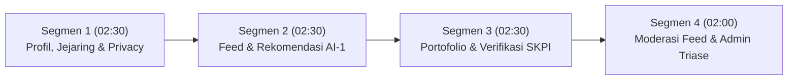

# 12 — Panduan Skenario Demo & Sidang Tugas Besar

**Proyek:** CampusFolio — Campus Social Media & Portfolio Platform  
**Rilis:** v1.0.0 (Academic Capstone Release)  
**Estimasi Durasi Presentasi Sidang:** 7 – 10 Menit  
**Target Penguji:** Dosen Pembimbing & Dosen Penguji Capstone  
**Penyusun:** Hustler, Hipster, & Hacker (Team 3)  

---

## 1. Persiapan Lingkungan Demo (Pre-Demo Setup)

### 1.1 Persiapan Data Bersih (Idempotent One-Command Reset)
Sebelum presentasi dimulai di hadapan penguji, jalankan perintah reset seeder berikut di terminal untuk memastikan data demo berada pada status awal yang bersih dan konsisten:

```bash
python src/backend/app/db/seed.py --reset --demo
```

### 1.2 Daftar Kredensial Akun Sidang (Demo Personas)

| Peran | Nama Akun | Email Login | Kata Sandi | Tujuan Demonstrasi |
| :--- | :--- | :--- | :--- | :--- |
| **Mahasiswa (Hacker)** | Moh. Rifqi Dwi Ardiansyah | `rifqi@campus.ac.id` | `password123` | Profil teknis, feed cari partner, pencarian rekomendasi kolaborator AI |
| **Mahasiswa (Hipster)** | Hakim | `hakim@campus.ac.id` | `password123` | Desain antarmuka mobile, portofolio SKPI terverifikasi |
| **Mahasiswa (Hustler)** | Ramadhan (Rama) | `ramadhan@campus.ac.id` | `password123` | Permintaan teman masuk, konten feed contoh pelaporan |
| **Moderator (Kaprodi TI)**| Dr. Ir. Budi Santoso, M.Kom | `kaprodi.ti@campus.ac.id` | `kaprodipassword123` | Verifikasi SKPI prodi TI & moderasi feed prodi TI |
| **Moderator (Kaprodi SI)**| Dr. Sri Wahyuni, S.Kom., M.T.| `kaprodi.si@campus.ac.id` | `kaprodipassword123` | Demonstrasi isolasi otorisasi lintas program studi |
| **Admin Kampus** | Super Admin Kemahasiswaan | `admin@campus.ac.id` | `adminpassword123` | Triase laporan aduan pengguna & takedown darurat |

---

## 2. Struktur Alur Skenario Demo (7 – 10 Menit)



---

### Segmen 1: Beranda, Profil Mahasiswa, & Privasi Pemblokiran (00:00 – 02:30)
**Fokus Story:** US-01 s.d. US-05, US-13, US-14, US-18  
**Aktor:** `rifqi@campus.ac.id` dan `hakim@campus.ac.id`

1. **Login & Dashboard Mahasiswa (US-01, US-18):**
   - Masuk sebagai Rifqi (`rifqi@campus.ac.id`).
   - Tunjukkan kartu Dashboard Mahasiswa: total poin SKPI aktif, badge verifikasi, notifikasi masuk, dan status pertemanan.
2. **Eksplorasi Profil & Keahlian (US-02, US-03):**
   - Buka halaman Profil Saya. Tunjukkan daftar keahlian (*skills*) berjenjang (`mahir`, `menengah`, `pemula`) dan minat (*interests*).
   - Tunjukkan keterbukaan: mahasiswa dapat menambah atau mengubah tag keahlian secara mandiri (Batasan AI #3).
3. **Pencarian Mahasiswa & Pertemanan (US-04, US-13):**
   - Cari mahasiswa dengan kata kunci `"Hakim"` atau `"UI/UX"`.
   - Tunjukkan status hubungan yang sudah saling berteman (*mutual friend*).
4. **Demonstrasi Isolasi Pemblokiran Anti-Leak (US-14):**
   - Tunjukkan skenario di mana Aisyah memblokir Dimas.
   - Buka sesi Dimas (`dimas@campus.ac.id`), lalu coba akses profil Aisyah langsung via URL `/users/{aisyah_id}` atau cari di menu pencarian.
   - **Poin Presentasi ke Penguji:** *"Sistem mengembalikan respons HTTP 404 Not Found secara simetris di 8 permukaan aplikasi (feed, profil, search, rekomendasi, friend request). Sistem tidak membocorkan keberadaan akun pihak pemblokir (Zero Leakage Principle)."*

---

### Segmen 2: Linimasa Kampus & AI Recommender Kolaborator (02:30 – 05:00)
**Fokus Story:** US-06, US-07, US-08, US-09, US-10  
**Aktor:** `rifqi@campus.ac.id`

1. **Linimasa Postingan Kampus (US-06, US-07):**
   - Tampilkan feed publik kampus.
   - Tunjukkan pemisahan postingan tipe `"umum"` dan postingan khusus `"cari_anggota"`.
2. **Eksekusi AI-1: Rekomendasi Kolaborator Rekan Proyek (US-08, US-09):**
   - Klik postingan Rifqi yang sedang mencari anggota: *"Mencari 1 anggota Frontend Engineer yang menguasai Next.js dan TailwindCSS..."*.
   - Klik tombol **"Dapatkan Rekomendasi AI"** (`POST /api/v1/recommendations/for-post/{id}`).
   - Tunjukkan hasil rekomendasi yang muncul dalam hitungan milidetik:
     - Mahasiswa disarankan (misal: Aisyah Putri).
     - Skor kemiripan teks TF-IDF.
     - Penjelasan rasional transparan: *"Memiliki keahlian Frontend yang melengkapi kebutuhan proyek Next.js Anda"* (Batasan AI #1).
3. **Pencarian Rekan Bebas Berdasarkan Kebutuhan (US-10):**
   - Masuk ke menu **Eksplorasi Rekan Proyek** (`POST /api/v1/recommendations/match`).
   - Masukkan kebutuhan proyek: *"Pengembangan aplikasi mobile Flutter dengan integrasi REST API"*.
   - Sistem secara cerdas menyarankan Hakim (UI/UX & Flutter) di peringkat teratas.
   - Berikan feedback ("Sangat Relevan") untuk mendemonstrasikan pencatatan feedback loop.

---

### Segmen 3: Manajemen Portofolio & Verifikasi SKPI Prodi (05:00 – 07:30)
**Fokus Story:** US-11, US-12, US-18  
**Aktor:** `rifqi@campus.ac.id` $\to$ Ganti Akun ke `kaprodi.ti@campus.ac.id`

1. **Pengajuan Dokumen Portofolio & SKPI (US-11):**
   - Sebagai Rifqi, buka menu Portofolio.
   - Tunjukkan item yang berstatus `terverifikasi` (Sertifikasi BNSP) dan item yang berstatus `menunggu_review` (Artikel Ilmiah SINTA 2).
   - Tunjukkan perhitungan kumulatif poin SKPI: Sertifikasi BNSP terhitung menyumbang poin resmi pada ringkasan kelulusan mahasiswa.
2. **Login Sebagai Kaprodi TI (US-12):**
   - Buka tab/browser baru atau logout, lalu login sebagai Kaprodi TI (`kaprodi.ti@campus.ac.id`).
   - Dashboard Kaprodi langsung menampilkan antrean FIFO portofolio mahasiswa TI yang membutuhkan verifikasi.
3. **Pemeriksaan & Keputusan Verifikasi SKPI (US-12):**
   - Buka detail pengajuan artikel ilmiah Rifqi.
   - Periksa dokumen dan nomor DOI.
   - Klik **"Setujui Portofolio"** dengan catatan: *"Telah diverifikasi sesuai pedoman SKPI prodi Informatika"*.
   - Status seketika berubah menjadi `terverifikasi`, dan poin SKPI Rifqi bertambah secara realtime.

---

### Segmen 4: Moderasi Konten Teks Feed & Triase Pelanggaran (07:30 – 09:30)
**Fokus Story:** US-15, US-16, US-17, US-18  
**Aktor:** `rifqi@campus.ac.id`, `kaprodi.ti@campus.ac.id`, `kaprodi.si@campus.ac.id`, `admin@campus.ac.id`

1. **Uji AI-2: Deteksi Konten Pelanggaran Berbasis Heuristik Evasif (US-15):**
   - Sebagai mahasiswa, buat postingan baru dengan kata kasar yang disamarkan (*adversarial evasion*), misal: `"Dasar 4nj1ng lu tooolooool"` atau variasi leetspeak/homoglif.
   - Sistem tidak langsung menayangkan postingan tersebut ke publik; status otomatis menjadi `menunggu_review` dengan catatan rekomendasi AI.
2. **Isolasi Program Studi Kaprodi (US-16, US-17):**
   - Login sebagai Kaprodi SI (`kaprodi.si@campus.ac.id`).
   - Kaprodi SI **tidak dapat melihat** atau men-takedown postingan mahasiswa TI (terisolasi 100% per program studi).
   - Login sebagai Kaprodi TI (`kaprodi.ti@campus.ac.id`): postingan mahasiswa TI muncul di antrean moderasi.
3. **Triase Laporan & Takedown Formal Admin (US-16, US-17):**
   - Login sebagai Super Admin Kemahasiswaan (`admin@campus.ac.id`).
   - Buka menu **Pusat Moderasi & Aduan Kampus**.
   - Periksa postingan yang dilaporkan oleh pengguna.
   - Lakukan tindakan penindakan (*Takedown*) dengan memasukkan alasan penindakan resmi: *"Melanggar etika komunikasi sivitas akademika"*.
   - Media dan teks langsung di-quarantine; notifikasi otomatis dikirimkan ke pihak pembuat konten (Prinsip *Human-in-the-Loop*).

---

## 3. Rencana Kontingensi Sidang (Contingency Plan)

| Kendala Saat Sidang | Penyebab Potensial | Tindakan Mitigasi Cepat (SOP) |
| :--- | :--- | :--- |
| **Koneksi Internet Kampus Terputus / Throttled** | Gangguan WiFi ruangan sidang | Nyalakan container DB lokal: `docker run --name campusfolio-db -e POSTGRES_PASSWORD=postgres -e POSTGRES_DB=campusfolio_db -p 5432:5432 -d postgres:15`, jalankan migrasi `alembic upgrade head`, lalu seeder `python src/backend/app/db/seed.py --reset --demo`. Seluruh sistem berjalan 100% luring (*offline*) di `localhost:8000`. |
| **Data Demo Rusak / Berantakan Akibat Pengujian Spontan Penguji** | Penguji meminta mencoba input acak | Buka terminal dan ketik satu baris perintah: `python src/backend/app/db/seed.py --reset --demo`. Dalam 3 detik seluruh data kembali ke kondisi sempurna. |
| **Layanan AI Lambat / Timeout** | Beban memori CPU laptop | Sistem secara otomatis mengaktifkan mekanisme degradasi anggun (*Graceful Degradation* / Batasan AI #4) ke pencocokan kata kunci dasar tanpa memicu error HTTP 500. |
| **Gambar Portofolio Gagal Terunggah** | Supabase Storage unreachable | Sistem otomatis beralih (*fallback*) menyimpan file ke direktori lokal `static/` yang tetap dapat diakses di browser demo. |
